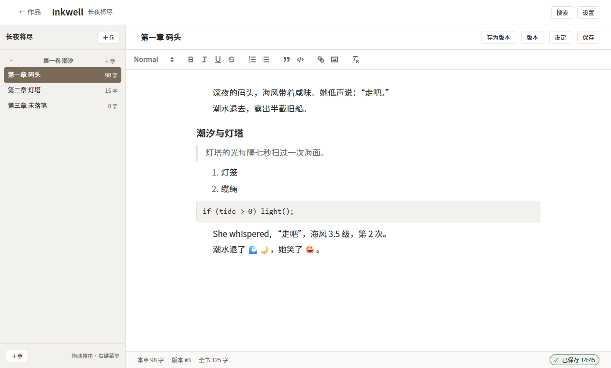
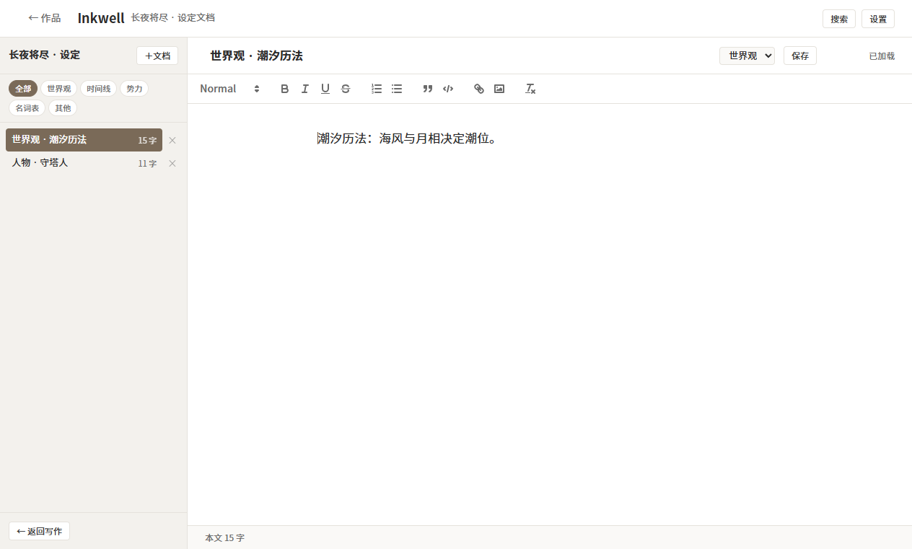
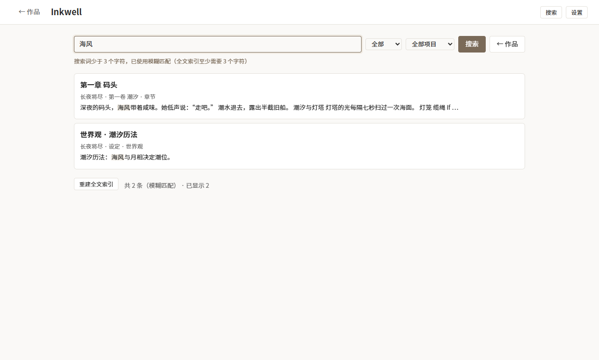
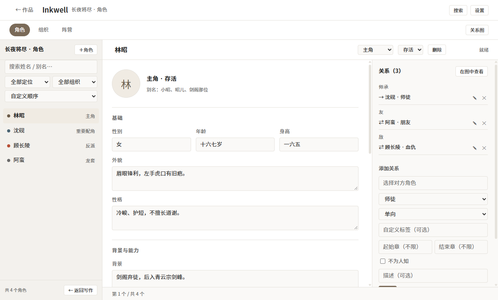
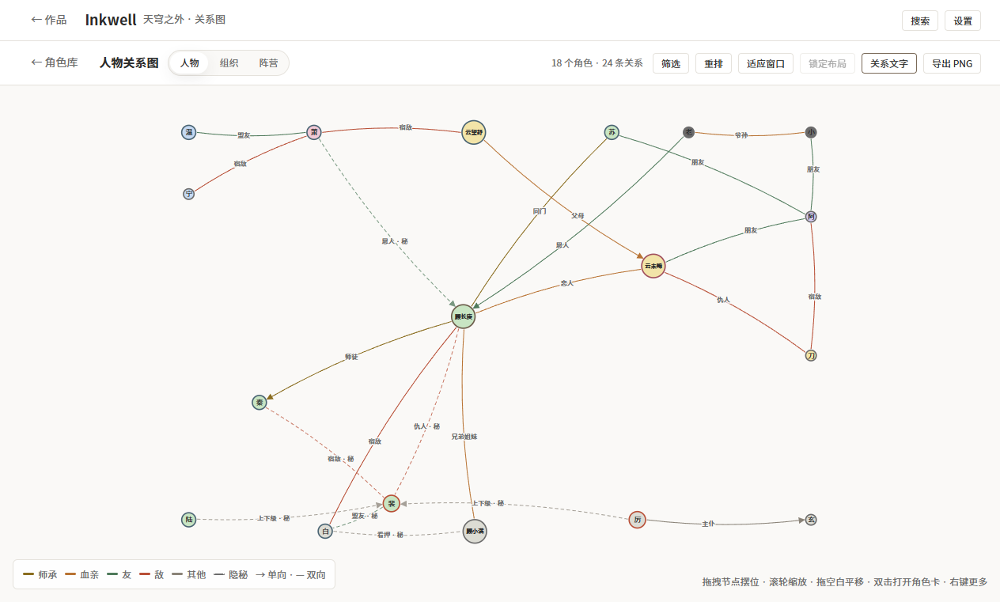
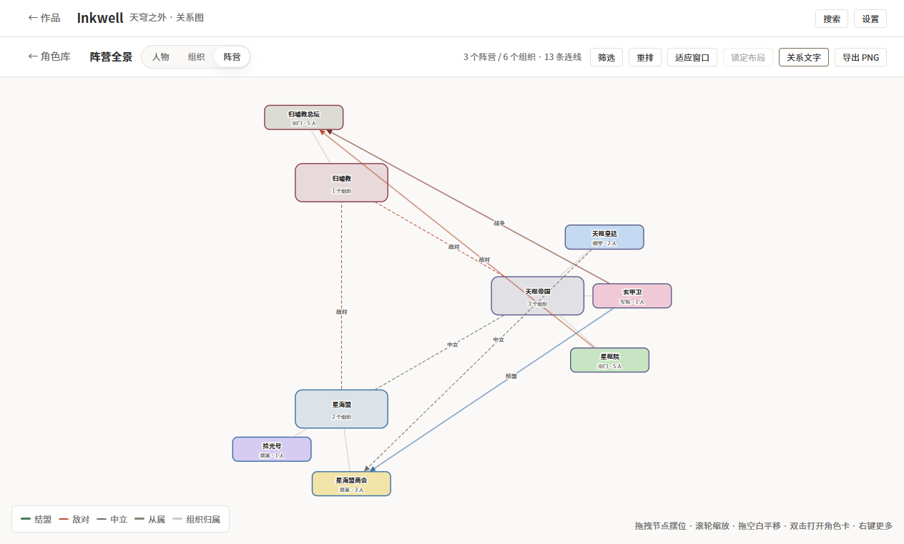
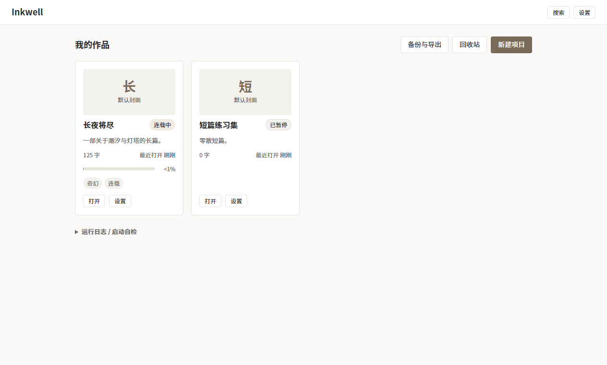

<div align="center">
  
</div>

# Inkwell

<p align="center">
  <a href="https://github.com/jiekej984/InkWell/releases/latest"></a>
  
  
  
</p>

<p align="center"><strong>一个窗口写完一本书。</strong><br>
大纲、正文、设定、全文检索、版本快照、备份恢复都在同一个应用里。<br>
所有数据只存在你自己的硬盘上：没有账号、没有云同步，断网也照常写。</p>

<div align="center">
  
</div>

---

## 它能做什么

| 能力 | 说明 |
|---|---|
| **大纲树** | 卷 → 章两级；拖拽排序（卷内 / 跨卷）、右键重命名 / 删除 / 标记定稿、F2 改章节信息 |
| **正文编辑** | Quill 富文本：标题、引用、列表、代码块、链接、图片；图片本地存放、签名访问 |
| **中文排版** | 正文 17px / 行高 1.9 / 行宽 ≤760px / 首行缩进 2 字符，专为中文长文调过 |
| **自动保存** | 停输 3 秒落盘；状态栏显示「保存中 / 已保存 HH:MM / 保存失败」；失败可重试或导出本章 |
| **不怕断电** | 切换、失焦、关窗都会先本地暂存；强杀进程最多丢 30 秒输入，下次打开自动补写 |
| **版本快照** | 自动（≥5 分钟且 ≥200 字）、手动、定稿三类；可逐行对比差异、回滚到任意历史版本 |
| **设定文档** | 世界观 / 时间线 / 势力 / 名词表 / 其他，五类分类；设定字数不计入正文 |
| **角色库** | 14 个固定字段 + 别名 + 自定义字段（灵根、本命剑等）+ 立绘；五种定位色、状态与标签 |
| **三层关系** | 大立场 → 组织 → 角色；20 类角色关系（师徒/血亲/恋人/宿敌…），单/双向、生效章、隐秘；成员职位 / 主组织 / 隐蔽身份 |
| **关系图** | 人物力导向 / 组织层级树 / 阵营列式全景三种模式；拖拽摆位、缩放平移、筛选、布局持久化、PNG 导出；关系名直接标在线上 |
| **全文检索** | 章节正文 + 设定文档一起搜，命中高亮、短词模糊降级、结果可翻页 |
| **章内查找** | Ctrl+F 打开查找条，n / N 或 Enter / Shift+Enter 跳转，区分大小写，Esc 关闭 |
| **导出** | 单章或整本导出 TXT / Markdown，500 万字全书约 0.3 秒 |
| **回收站** | 删掉的章节 / 卷 / 设定 / 角色 / 组织 / 阵营进回收站，30 天内可恢复 |
| **备份与自检** | 每日自动备份、迁移前备份、手动立即备份；数据库完整性自检、诊断包（不含正文） |
| **快捷键** | Ctrl+N / S / F、Ctrl+Shift+F / V / E、Esc；与中文输入法共存（见 FAQ） |
| **单实例** | 重复双击不会再开一个进程，而是把已开着的窗口叫回前台 |

<div align="center">
  
  
</div>

### V2.0 角色库与关系图

<div align="center">
  
  
  <br>
  
</div>

## 下载与安装（Windows 10 / 11 x64）

**不需要安装 Python，也不需要装运行时。**

1. 到 [Releases](https://github.com/jiekej984/InkWell/releases/latest) 下载 `Inkwell-2.0.0-win-x64.zip`
2. 解压到任意**可写目录**（比如 `D:\Inkwell`；**不要放 `Program Files`**，见下）
3. 双击 `Inkwell.exe`

```
Inkwell-2.0.0-win-x64.zip
└── Inkwell/                 ← 解压出来是文件夹，不是单文件
    ├── Inkwell.exe          ← 双击这个
    └── _internal/           ← 运行时与前端资源，不能删、exe 也不能单独拿走
```

| 你可能关心 | 说明 |
|---|---|
| **数据在哪** | 默认在 `Inkwell\data\`（书库、备份、导出、图片、日志都在里面）。换电脑 = 把这个文件夹拷走 |
| **想放别处** | 设环境变量 `INKWELL_DATA_DIR=D:\我的书库`；或在 exe 旁边放一个 `portable.txt` 走便携模式 |
| **首次运行提示** | 未做代码签名，Windows SmartScreen 可能拦一下：点**更多信息 → 仍要运行**。不放心的可以按下面的开发说明自行构建 |
| **WebView2** | Windows 11 / 新版 Windows 10 一般自带；万一缺失，应用会弹窗给出官方下载地址，装完即可用 |
| **怎么更新** | 没有自动更新：下载新版 zip，解压覆盖到同一个 `Inkwell\` 目录即可，`data\` 会保留（覆盖前建议先备份整个目录） |
| **校验文件** | 每个 Release 都带 `SHA256SUMS.txt`：`Get-FileHash .\Inkwell-2.0.0-win-x64.zip -Algorithm SHA256` 对照 |
| **卸载** | 直接删掉 `Inkwell\` 文件夹即可（数据也在里面，想留稿先备份 `data\`） |
| **多开** | 同一个数据目录只允许一个实例；不同数据目录可以各开一个（例如正文一个库、素材一个库） |

## 第一次使用

1. 打开后点 **新建项目**（书名、简介可选）
2. 应用会自动建好第一卷和第一章，光标已经在正文里，直接写
3. 左侧大纲树管理章节；点「设定」写人物、世界观、时间线
4. 写作页右上角点 **角色**：建角色、组织、阵营，再打开「关系图」看三层关系
5. 想找某段剧情，按 **Ctrl+Shift+F** 全局搜索
6. 关窗即保存；想留一个「这一稿」的节点，按 **Ctrl+S** 生成手动快照

<div align="center">
  
</div>

## 快捷键

| 按键 | 作用 | 生效范围 |
|---|---|---|
| `Ctrl+N` | 新建章节 | 写作页 |
| `Ctrl+S` | 保存（并生成手动快照） | 写作页；设定页保存当前文档 |
| `Ctrl+F` | 章内查找 | 写作页 |
| `Ctrl+Shift+F` | **全局搜索** | 所有页面 |
| `Ctrl+Shift+V` | 版本历史 | 写作页 |
| `Ctrl+Shift+E` | 备份与导出 | 所有页面 |
| `Esc` | 关闭查找条 / 关闭对话框 | 视上下文 |
| `Enter` / `Shift+Enter` | 查找：下一处 / 上一处 | 查找条内 |
| `n` / `N` | 查找：下一处 / 上一处 | 写作页 |

## 数据与隐私

- **完全离线**：不联网也能用；启动只在本机回环地址（`127.0.0.1`）起一个随机端口的服务，用一次性 token 鉴权，其他程序访问不了
- **无账号、无遥测**：前端报错只写到本机日志，不上传；诊断包也不含正文
- **备份**：每日自动备份 + 迁移前备份，保留策略见应用内「备份与恢复」页
- **迁移**：换电脑时把 `Inkwell\data\` 整个拷过去即可；建议退出应用后再同步 / 备份（避免同步盘和 SQLite 抢文件）

## 常见问题

<details>
<summary><b>按 Ctrl+Shift+F 没反应？</b></summary>

微软拼音在**中文输入态**把 `Ctrl+Shift+F` 当成了自带的「简体 / 繁体切换」系统热键。Inkwell 已经做了
keyup 兜底，正常情况下仍能弹出全局搜索；如果你的机器上还是被输入法吃掉，可以在
「设置 → 时间和语言 → 中文(简体) → 微软拼音 → 选项 → 按键」里把「简体/繁体切换」改成别的组合。
细节见 [`docs/故障排查.md`](docs/故障排查.md)。
</details>

<details>
<summary><b>能不能放到 Program Files？</b></summary>

不建议。默认数据目录在 exe 同目录的 `data\`，`Program Files` 不可写，应用会回退到「文档\Inkwell」。
想放受保护目录又想让数据在别处，就设 `INKWELL_DATA_DIR`。
</details>

<details>
<summary><b>为什么第一次运行被杀软 / SmartScreen 拦？</b></summary>

因为 exe 未做代码签名（个人项目，没有买证书）。点「更多信息 → 仍要运行」即可。
所有源码都在本仓库，可以用 `tools/build_release.py` 自行构建同一个包。
</details>

<details>
<summary><b>支持 macOS / Linux 吗？</b></summary>

V1.0 只做 Windows 10/11 x64。后端是 Python + SQLite，理论上可移植，但前端外壳（pywebview/WebView2）
与打包脚本都是按 Windows 写的，未做其他平台验证。
</details>

## 技术栈

pywebview（WebView2 外壳）+ FastAPI/uvicorn（本机回环服务）+ SQLite/SQLAlchemy + FTS5（中文 trigram 检索）
+ Quill 2.x（离线副本，无构建步骤）。前端是原生 ES Module + CSS，没有 Node 构建链。
打包用 PyInstaller onedir，产物约 54 MB。

## 开发与构建

```bat
:: 安装依赖（Python 3.11）
.venv\Scripts\python.exe -m pip install -r requirements.lock

:: 从源码运行
.venv\Scripts\python.exe main.py

:: 跑测试（Python + 前端纯函数单测）
.venv\Scripts\python.exe -m pytest tests -q

:: 出发布包（构建 → 冻结自检 → 开窗首屏 → 单实例 / WebView2 引导回归 → zip + SHA256）
.venv\Scripts\python.exe tools\build_release.py
```

环境搭建、目录结构、数据目录优先级、窗口冒烟与性能实测等，见
[`docs/开发者指南.md`](docs/开发者指南.md)。

## 文档

| 文档 | 内容 |
|---|---|
| [`docs/开发者指南.md`](docs/开发者指南.md) | 环境、运行、测试、目录结构、数据目录、安全约定、出包与性能命令 |
| [`docs/项目报告/Inkwell项目报告_v0.8.md`](docs/项目报告/Inkwell项目报告_v0.8.md) | 设计基线（需求、接口、决策、验收标准） |
| [`docs/版本更新/阶段四_验收单.md`](docs/版本更新/阶段四_验收单.md) | 发布前验收：构建闸门、性能实测、发布物料 |
| [`docs/版本更新/2026-10-24_2019_阶段四_4.4性能实测汇报.md`](docs/版本更新/2026-10-24_2019_阶段四_4.4性能实测汇报.md) | 冷启动 0.98s / 打开 5 万字章 97ms / 检索 14ms / 导出 505 万字 0.31s |
| [`docs/故障排查.md`](docs/故障排查.md) | 已知问题与环境排查（窗口打不开、输入法抢键、FTS5 误报等） |
| [`DECISIONS.md`](DECISIONS.md) / [`CHANGELOG.md`](CHANGELOG.md) | 决策留痕 / 变更日志 |

## 许可证

[MIT](LICENSE) © 2026 Inkwell contributors

